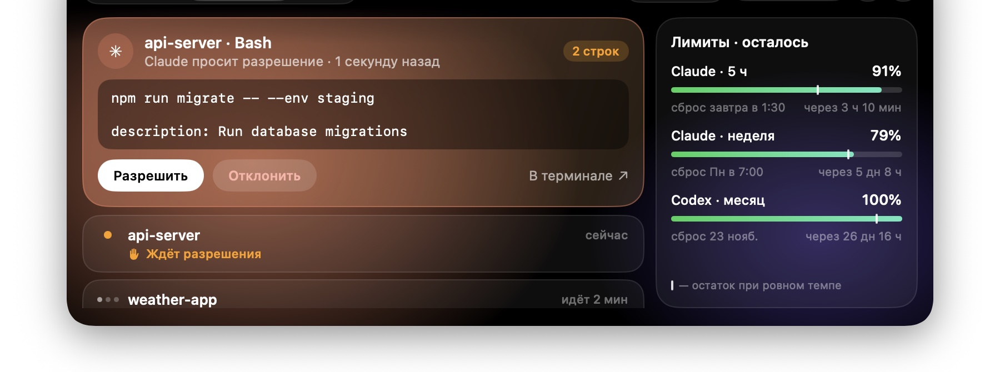
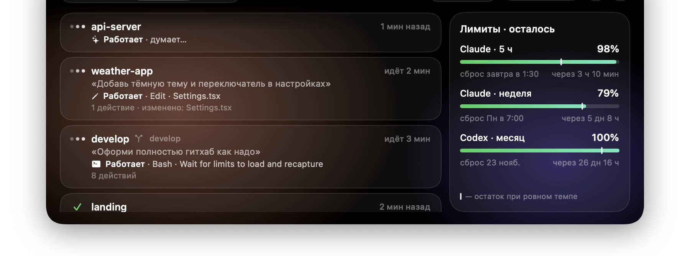

<div align="center">

# Nook

**A MacBook notch that works for you.**
Claude Code and Codex agents, music, clipboard, files, calendar and timer — right under the camera.

[](https://github.com/olehmrvz/nook/releases/latest)


[](LICENSE)

[**Download**](https://github.com/olehmrvz/nook/releases/latest/download/Nook.zip) · [Development](docs/DEVELOPMENT.md)



</div>

> The app interface is in Russian for now. Menu names below are given in English with the Russian label in brackets.

## Why

You started a few agents and switched to the browser. Nook shows in the notch which of them is working, which
is done and which is waiting for you. Allow, deny or answer an agent's question right there, without hunting
for the terminal tab. Everything else usually scattered around the screen lives in the notch too.

<p align="center"></p>

## Features

**Agents**
- Claude Code and Codex sessions: current action, your request, branch, duration, edited files.
- Permission requests in the notch: Allow, Always, Deny or "in terminal". You see everything you approve,
  not only the description.
- Agent questions with options and plan review: approve, approve with auto-accepted edits, or send back a note.
- A "done" island when an agent finishes, with what the turn did: files edited, tests passed or failed,
  commit, push. One click brings back its terminal tab (herdr, tmux).
- Reply to an agent from the notch: the text goes straight into its herdr or tmux pane.
- Claude (5 h and week) and Codex limits with reset times, and a warning when the 5 h window runs low.
- Tokens and API-price cost per Claude session and for today (read from local transcripts).
- A warning when one of your processes loads the Mac for minutes (a dev server an agent left running),
  with a button to end it.
- ☕ Coffee: keeps the Mac awake while agents work overnight.

**Every day**
- Music from any app: Spotify, Music, a browser tab, podcasts.
- Clipboard (⌃⌘V): 300 items, pins, search, text from images. Password-manager items are never saved.
- Shelf: drop a file on the notch, drag it out later or AirDrop it. Screenshots land there by themselves.
- Calendar and reminders, a "Join" button 5 minutes before a meeting.
- Timer and Pomodoro, notes, mirror (camera), teleprompter for video (`Nook --prompt`).
- Focus mode: Pomodoro with coffee on, and no notification islands while a focus block runs.
- ⌨︎ Keyboard lock for 30 seconds to wipe it clean. The trackpad keeps working.
- Islands: notifications, calls, AirPods, downloads, long terminal commands.
- Volume, brightness and Do Not Disturb shown in the notch instead of the system HUD.
- Weather, battery, choice of display for the notch.

## Install

1. Download [Nook.zip](https://github.com/olehmrvz/nook/releases/latest/download/Nook.zip) and unpack it.
2. Move `Nook.app` to Applications and open it.
3. macOS says it cannot verify the developer: Nook is not notarized by Apple.
   Open **System Settings → Privacy & Security → "Open Anyway"**.
   If macOS says the app is damaged, run this in Terminal and open it again:
   ```sh
   xattr -dr com.apple.quarantine /Applications/Nook.app
   ```
4. Hover the notch to open the panel. Settings: ⚙︎ in the panel or the menu bar icon.

Claude Code and Codex connect by themselves on first launch. Restart agents that are already running.
Codex may ask once whether to trust Nook's hooks — allow it.

Requires an Apple Silicon Mac with macOS 14 or later. On a Mac without a notch, Nook draws a small pill at the top.

## Updates

Nook checks for a new version every 6 hours and installs it when the panel is closed. Check by hand:
⚙︎ → Updates (Обновления) → Check now (Проверить сейчас). Turn off: same menu, Update automatically
(Обновлять автоматически).

## Security and privacy

- No analytics, account or ads. Network access only for weather (Open-Meteo, location rounded to ~1 km) and
  updates (GitHub).
- All data stays on your Mac in `~/Library/Application Support/Nook`, readable only by your user account.
- An update is installed only if it is signed with the same certificate as your copy.
- An agent cannot approve its own request: only your answer counts.
- Notification text is hidden in the notch until you turn it on.

Check that your copy is genuine:
```sh
codesign -d -r- /Applications/Nook.app
# must end with: certificate leaf = H"76a699582536149bb53212178f4a1b2a2dc15cc1"
```
Each release lists the SHA-256 of the zip. Found a vulnerability? See [SECURITY.md](SECURITY.md).

## Build from source

```sh
xcode-select --install   # once: build tools
./make-cert.sh           # once: a certificate, so macOS keeps permissions across builds
./install.sh             # build, install to /Applications and start
```
Details: [docs/DEVELOPMENT.md](docs/DEVELOPMENT.md).

## License

[MIT](LICENSE) © 2026 Oleh Yaitsov
