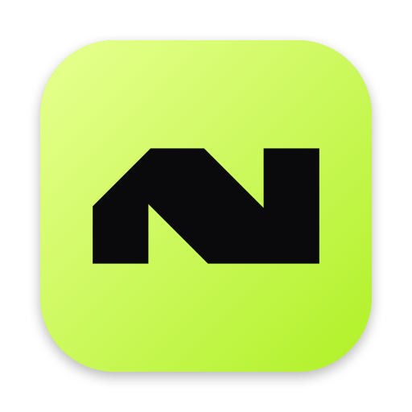
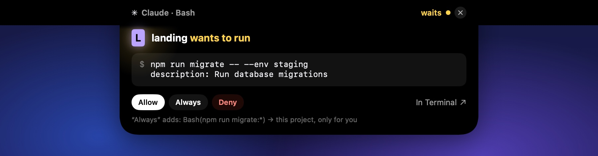
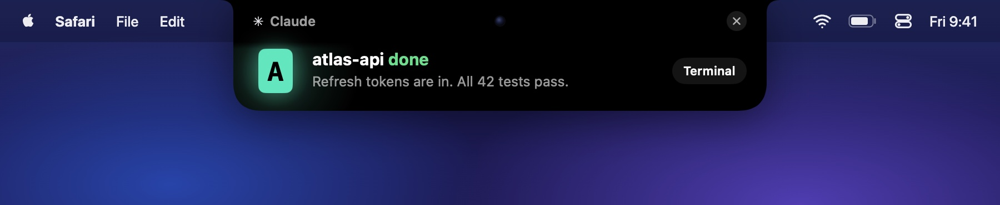
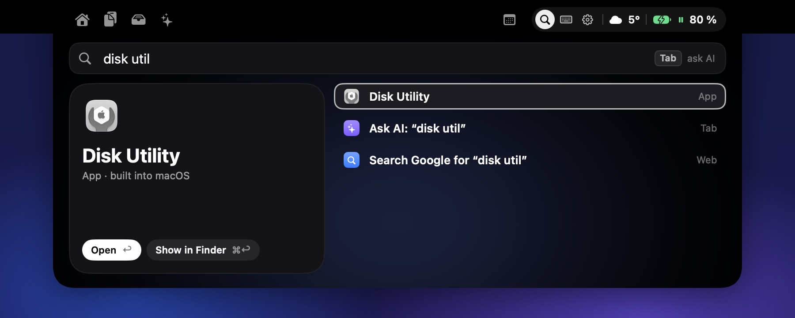
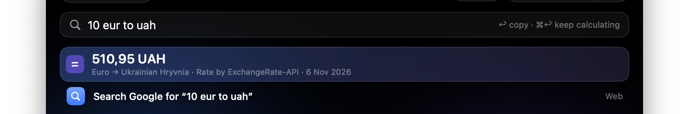

<div align="center">



# Nook

**Your MacBook notch, put to work.**

Answer Claude Code and Codex right from the notch, see what each agent did,
and keep a launcher, clipboard, dictation and music one hover away.

[](https://github.com/olehmrvz/nook/releases/latest)


[](LICENSE)

[**Download Nook.dmg**](https://github.com/olehmrvz/nook/releases/latest/download/Nook.dmg)

Free · open source · no account · signed and notarized by Apple



</div>

## Why Nook

You start a few agents and switch to the browser. One finishes, one needs your permission, and you find out ten
minutes later. Nook puts them in the notch: you see who works, who is done and who waits for you, and you answer
without hunting for the terminal tab.

The same notch replaces a handful of small utilities. It is one free app, and everything runs on your Mac.

## Features

### Agents — Claude Code and Codex

<p align="center"></p>

- **Always in sight.** The closed notch shows your project's letter under a blinking cursor. It stays lit while an
  agent waits for you.
- **Permission requests.** The request drops out of the notch with the exact command. Allow, Always, Deny, or answer
  in the terminal. An agent cannot approve its own request.
- **Questions and plans.** Pick one of the agent's options, or approve its plan, in one click.
- **What changed.** The feed shows results, not tool calls: each file with the lines it gained and lost, tests
  with their counts, commits and pushes, commands that failed.
- **When it's done.** A drop tells you what the turn did. In the feed you read the whole answer, with its lists,
  code and tables, next to what you asked and how long it took; a question the agent ends with stands out. One click
  brings back its terminal tab.
- **Reply from the notch.** Your text goes straight into the agent's herdr or tmux pane.
- **Limits and cost.** Claude (5 hours and week) and Codex limits with reset times, plus today's tokens and cost at
  API prices, read from local transcripts.
- **Process watch.** A warning when something an agent left running loads the Mac for minutes, with a button to end it.
- **Caffeine.** Keeps the Mac awake while agents work overnight.

### Search and calculator

<p align="center"></p>

- **⌥Space** opens one search for apps, System Settings, menu items of the app in front, open windows, files,
  Apple Shortcuts, emoji, quicklinks (`yt cats`) and your own shell commands. **⌘1** switches to the clipboard.
- **Calculator** as you type: `450 + 20%`, `5 km in miles`, `10 eur to usd`, `1 btc to eur`. The last rates are kept,
  so it works offline.

<p align="center"></p>

- An alias and a shortcut for anything in the search.

### AI

- Ask in the search and press Tab: the answer appears in the notch.
- Select text in any app, then fix, rewrite, shorten, summarize or translate it.
- Claude through your Claude Code login, a Claude API key, or Apple Intelligence on macOS 26.

### Dictation

- Hold right ⌥, speak, let go: the text appears where the cursor is.
- Speech recognition runs on your Mac (NVIDIA Parakeet, 25 European languages). Audio is never saved or sent.

### Windows and snippets

- Halves, thirds, quarters, maximize, center, next display — from the search or your own shortcuts.
  Rectangle's shortcuts in one click.
- Type a keyword such as `;sig` in any app and it turns into your text, with placeholders for the date,
  the clipboard and the cursor.

### Clipboard and shelf

- **⌃⌘V:** 300 items with a preview, pins, a filter by type and text from images. Type to filter, arrows to choose,
  Return pastes, ⌘C copies. Password managers are ignored.
- **Shelf:** drag a file to the notch and drop it on the shelf; drag it out later or AirDrop it. Screenshots land
  there by themselves.

### Every day

- Music from any app, the calendar with a Join button, a timer and Pomodoro with a focus mode, notes,
  a mirror and a teleprompter.
- Notifications, calls, AirPods, downloads and long terminal commands grow out of the notch. When AirPods jump to
  your iPhone, one click brings them back to the Mac.
- Volume, brightness and Do Not Disturb in the notch instead of the system HUD; weather and battery.
- Keyboard lock for 30 seconds, to wipe the keyboard clean.
- Sleeps while a game fills the screen: no notch over the game and nothing opens on hover. The search and clipboard
  shortcuts still work.
- A settings window, the tabs and buttons you want in the header; English, German, Ukrainian or Russian (or the
  system's language).

## Install

1. Download [Nook.dmg](https://github.com/olehmrvz/nook/releases/latest/download/Nook.dmg), open it and drag Nook
   to Applications.
2. Open Nook and hover the notch.

Claude Code and Codex connect by themselves on first launch; restart agents that were already running. Codex may ask
once whether to trust Nook's hooks — allow it. Settings: ⚙︎ in the panel or the menu bar icon.

Requires an Apple Silicon Mac with macOS 14 or later. On a Mac without a notch, Nook draws a small pill at the top.
Nook checks for updates every 6 hours and offers a new version in the notch; it installs when you click Install.

## Permissions

macOS asks for a permission the first time you use a feature that needs it.

| Permission | What for |
|---|---|
| Accessibility | snippets, windows, menu items in the search, AI on the selected text, pasting dictated text, keyboard lock, volume and brightness |
| Microphone | dictation, the teleprompter |
| Speech Recognition | the teleprompter follows your voice |
| Full Disk Access | notification islands (Nook reads the Notification Center database) |
| Calendars, Reminders | the calendar |
| Camera | the mirror, only while it is open |
| Location | weather |
| Contacts, Bluetooth, Automation | the caller's photo, AirPods battery, now playing in Spotify and Music |
| Desktop, Downloads folders | screenshots to the shelf, the downloads island |

## Privacy

- No account, no analytics, no ads. Your data stays in `~/Library/Application Support/Nook`.
- Nook goes online only for the weather, updates, exchange rates, the one-time dictation model download and AI
  when you ask.
- Updates install only if they are signed with Nook's Developer ID.

More: [SECURITY.md](SECURITY.md).

## Build from source

```sh
xcode-select --install   # once: build tools
./make-cert.sh           # once, without a Developer ID: macOS then keeps permissions across builds
./install.sh             # build, install to /Applications and start
```

Details: [docs/DEVELOPMENT.md](docs/DEVELOPMENT.md). Third-party notices: [NOTICE.md](NOTICE.md).

## Credits

- Speech recognition: NVIDIA Parakeet TDT 0.6B v3, moondream's Ultra and Redux re-trainings, and the Core ML
  conversions by FluidInference (all CC-BY-4.0). Details: [NOTICE.md](NOTICE.md).
- Exchange rates: [ExchangeRate-API](https://www.exchangerate-api.com); crypto rates:
  [currency-api](https://github.com/fawazahmed0/exchange-api) by fawazahmed0. Weather: [Open-Meteo](https://open-meteo.com).

## Support

Nook is free. If it helps you, you can say thanks in USDT:

- TRON (TRC-20): `TDQnp3XjR1yjFhDTxUfhgRAA9YuoitR9vd`
- Ethereum (ERC-20): `0x64aF41413b60d36eBf0148eA303AC3087301b2e8`

## License

[MIT](LICENSE) © 2026 Graphyte Labs

<p align="center"><sub>Made by <b>Graphyte Labs</b></sub></p>
