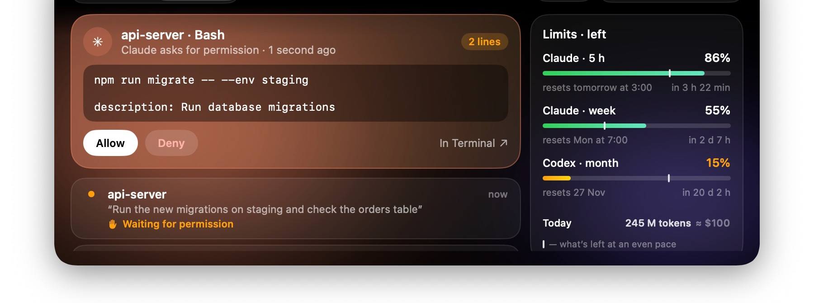
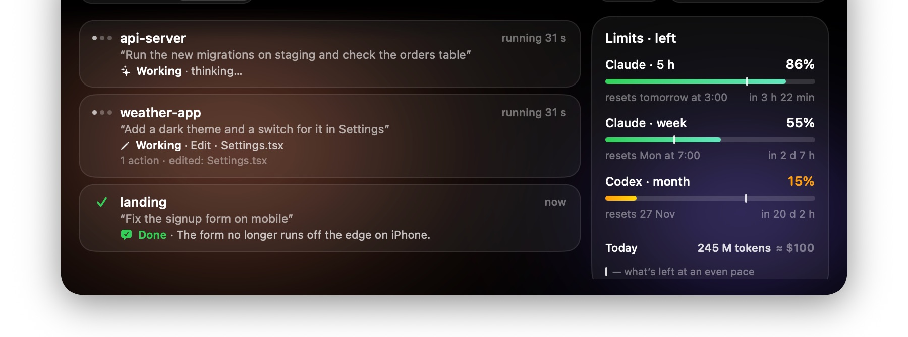

<div align="center">

# Nook

**A MacBook notch that works for you.**
Claude Code and Codex agents, a search with a calculator, AI, dictation, clipboard and music — right under the camera.

[](https://github.com/olehmrvz/nook/releases/latest)


[](LICENSE)

[**Download**](https://github.com/olehmrvz/nook/releases/latest/download/Nook.zip) · [Development](docs/DEVELOPMENT.md)



</div>

> Nook speaks English and Russian and follows the system language. To change it: Settings → General → Language.

## Why

You started a few agents and switched to the browser. Nook shows in the notch which of them is working, which
is done and which is waiting for you. Allow, deny or answer an agent's question right there, without hunting
for the terminal tab.

The notch also does the work of several small utilities: a launcher with a calculator, a clipboard manager,
a window manager, a text expander, AI for the selected text and dictation. It is one free app without an account,
and speech recognition runs on your Mac.

<p align="center"></p>

## Features

[Agents](#agents) · [Search](#search) · [Calculator](#calculator) · [AI](#ai) · [Dictation](#dictation) ·
[Windows](#windows) · [Snippets](#snippets) · [Clipboard](#clipboard) · [Every day](#every-day) · [Settings](#settings)

### Agents

- Claude Code and Codex sessions: current action, your request, branch, duration, edited files.
- The closed notch shows the project's first letter under a blinking terminal cursor. The cursor stays lit while
  a request waits for you.
- Permission requests in the notch: Allow, Always, Deny or "in terminal". You see everything you approve,
  not only the description.
- Agent questions with options and plan review: approve, approve with auto-accepted edits, or send back a note.
- A "done" island when an agent finishes, with what the turn did: files edited, tests passed or failed,
  commit, push. One click brings back its terminal tab (herdr, tmux).
- Reply to an agent from the notch: the text goes straight into its herdr or tmux pane.
- Claude (5 h and week) and Codex limits with reset times, and a warning when the 5 h window runs low.
- Tokens and API-price cost per Claude session and for today (read from local transcripts).
- A warning when one of your processes loads the Mac for minutes (a dev server an agent left running),
  with a button to end it.
- ☕ Caffeine: keeps the Mac awake while agents work overnight.

### Search

Press ⌥Space (or record your own shortcut) and type. The search opens on the display you work on, and the app
you pick opens there too.

<p align="center"></p>

- Apps, System Settings panes and Nook's commands (timer, Pomodoro, coffee, keyboard lock…). A word typed in the
  wrong keyboard layout still works: `ыфа` finds Safari. What you open often moves up.
- Menu items of the app in front, with their shortcuts: run a menu command without the mouse.
- Open windows of all apps, minimized ones too.
- Files by name (Spotlight), Apple Shortcuts and emoji (`:heart`, `:сердце`).
- Quicklinks: `yt cats` opens a YouTube search. `maps`, `translate` and `gh` are ready; add your own with `{query}`.
- A typed web address opens in the browser. Nothing found? Search Google or look the word up in the Dictionary.
- Your own shell commands; the last line of the output shows in an island.
- An alias and a shortcut for any app, System Settings pane, command or AI action.

### Calculator

Results appear in the search as you type. Return copies the result, ⌘Return keeps calculating with it.

<p align="center"></p>

- Arithmetic and percentages: `10+10`, `450 + 20%`, `2^10`, `sqrt 25`.
- Units: `5 km in miles`, `100 f to c`.
- Currencies: `10 eur to uah`, `€20 to GBP`, `500 гривен в евро`. A bare amount (`100 usd`) converts to the currency
  of your region.
- Crypto: `1 btc to eur`, `100 usdt в гривны`.
- Rates update once a day. The last rates are kept, so the calculator also works offline.

### AI

- Ask in the search: type a question and press Tab. The answer appears in the notch.
- Select text in any app, then fix it, rewrite it, shorten it, summarize it, or translate it to English or Russian.
  The new text replaces the selection; a summary opens in the search for you to read.
- Answers come from Claude through your Claude Code login (no key needed), from a Claude API key, or from
  Apple Intelligence on macOS 26.

### Dictation

- Hold right ⌥, speak, let go: the text appears where the cursor is. You can record another key or combination,
  or switch to "press to start, press to stop".
- The notch shows that it listens: a level meter and a timer.
- Recognition runs on your Mac with NVIDIA's Parakeet model: 25 European languages, Russian and Ukrainian included.
  The language is detected automatically.
- Two models: Accurate (about 630 MB) and Fast (about 220 MB, macOS 15 or later). The model downloads once from
  Hugging Face and is checked against pinned checksums. Audio is never saved or sent.
- Pick the start and end sounds, or none. Other sound goes down to 5 % while you speak and comes back after.
- Off until you turn it on: Settings → Dictation.

### Windows

Halves, quarters, thirds and two-thirds, maximize, a reasonable size, center, larger, smaller, next or previous
display, and restore — from the search or with your own shortcuts. One click sets Rectangle's shortcuts
(⌃⌥ + arrows and the rest).

### Snippets

- Type a keyword (`;sig`) in any app, and it turns into your text.
- Placeholders: `{clipboard}`, `{date}`, `{time}`, `{datetime}`, `{day}`, `{uuid}`, `{cursor}` (the caret lands there),
  and also `{date format="dd.MM.yyyy"}`, `{time offset="+3h"}` and `{clipboard offset=1}`.
- Insert a snippet from the search too. Each snippet is a plain `.md` file in
  `~/Library/Application Support/Nook/Snippets`.

### Clipboard

- ⌃⌘V: 300 items, pins, search, a filter (text, links, images, files) and text from images.
- A keep time, and apps to ignore (Keychain Access and Passwords by default). Password-manager items are never saved.
- "Paste the next one from the clipboard" pastes a list item by item, in order.

### Every day

- Music from any app: Spotify, Music, a browser tab, podcasts.
- Shelf: drop a file on the notch, drag it out later or AirDrop it. Screenshots land there by themselves.
- Calendar and reminders, a "Join" button 5 minutes before a meeting.
- Timer and Pomodoro, notes, mirror (camera), teleprompter for video (`Nook --prompt`).
- Focus mode: Pomodoro with coffee on, and no notification islands while a focus block runs.
- ⌨︎ Keyboard lock for 30 seconds to wipe it clean. The trackpad keeps working.
- Islands: notifications, calls, AirPods, downloads, long terminal commands.
- Volume, brightness and Do Not Disturb shown in the notch instead of the system HUD.
- Weather, battery, choice of display for the notch.

### Settings

- A settings window: ⚙︎ in the panel, "Nook Settings" in the search, or the menu bar icon → Settings….
- Language: English or Russian, or the system's.
- Panel: choose which tabs and buttons the header shows. The header uses the space that is left.
- Privacy shows which permissions Nook has and opens the right page of System Settings.

## Install

1. Download [Nook.zip](https://github.com/olehmrvz/nook/releases/latest/download/Nook.zip) and unpack it.
2. Move `Nook.app` to Applications and open it.
3. macOS says it cannot verify the developer: Nook is not notarized by Apple.
   Open **System Settings → Privacy & Security → "Open Anyway"**.
   If macOS says the app is damaged, run this in Terminal and open it again:
   ```sh
   xattr -dr com.apple.quarantine /Applications/Nook.app
   ```
4. Hover the notch to open the panel. Settings: ⚙︎ in the panel or the menu bar icon.

Claude Code and Codex connect by themselves on first launch. Restart agents that are already running.
Codex may ask once whether to trust Nook's hooks — allow it.

Requires an Apple Silicon Mac with macOS 14 or later. On a Mac without a notch, Nook draws a small pill at the top.

## Permissions

macOS asks for a permission when you first use a feature that needs it.

| Permission | What for |
|---|---|
| Accessibility | snippets, windows, menu items and open windows in the search, AI on the selected text, pasting dictated text, keyboard lock, volume and brightness in the notch |
| Microphone | dictation, the teleprompter |
| Speech Recognition | the teleprompter follows your voice |
| Full Disk Access | notification islands (Nook reads the Notification Center database) |
| Calendars, Reminders | the calendar tab |
| Camera | mirror, only while it is open |
| Location | weather |
| Contacts | the caller's photo |
| Bluetooth | AirPods battery |
| Automation | now playing in Spotify and Music |
| Desktop, Downloads folders | screenshots to the shelf, the downloads island |

## Updates

Nook checks for a new version every 6 hours and installs it when the panel is closed. Check by hand:
the menu bar icon → Check for Updates…, or Settings → Updates → Check Now. Turn off: same page, Update automatically.

## Security and privacy

- No analytics, account or ads. Nook goes online only for:
  - weather (Open-Meteo, location rounded to ~1 km);
  - updates (GitHub);
  - currency and crypto rates for the calculator, once a day (ExchangeRate-API; currency-api by fawazahmed0 through jsDelivr);
  - the dictation model, once, when you download it (Hugging Face);
  - AI, only when you ask: the text goes to the provider you chose (Anthropic for Claude; Apple Intelligence
    stays on the Mac).

  Dictated audio stays on the Mac. File search uses Spotlight on the Mac.
- All data stays on your Mac in `~/Library/Application Support/Nook`, readable only by your user account.
- An update is installed only if it is signed with Nook's Developer ID (or the same certificate as your copy).
- An agent cannot approve its own request: only your answer counts.
- Notification text is hidden in the notch until you turn it on.
- A Claude API key, if you add one, is kept in the macOS keychain.

Check that your copy is genuine:
```sh
codesign -d -r- /Applications/Nook.app
# must end with: certificate leaf = H"76a699582536149bb53212178f4a1b2a2dc15cc1"
```
Each release lists the SHA-256 of the zip. Found a vulnerability? See [SECURITY.md](SECURITY.md).

## Support the author

Nook is free. If it helps you, you can thank the author in USDT:

- TRON (TRC-20): `TDQnp3XjR1yjFhDTxUfhgRAA9YuoitR9vd`
- Ethereum (ERC-20): `0x64aF41413b60d36eBf0148eA303AC3087301b2e8`

Send only USDT, and only on the network named next to the address. QR codes: the menu bar icon → Say Thanks….

## Build from source

```sh
xcode-select --install   # once: build tools
./make-cert.sh           # once, without a Developer ID: a certificate, so macOS keeps permissions across builds
./install.sh             # build, install to /Applications and start
```
Details: [docs/DEVELOPMENT.md](docs/DEVELOPMENT.md).

## Credits

- Speech recognition: NVIDIA Parakeet TDT 0.6B v3, moondream's Ultra and Redux re-trainings, and the Core ML
  conversions by FluidInference (all CC-BY-4.0). Details: [NOTICE.md](NOTICE.md).
- Exchange rates: [ExchangeRate-API](https://www.exchangerate-api.com). Crypto rates:
  [currency-api](https://github.com/fawazahmed0/exchange-api) by fawazahmed0.
- Weather: [Open-Meteo](https://open-meteo.com).

## License

[MIT](LICENSE) © 2026 Oleh Yaitsov
